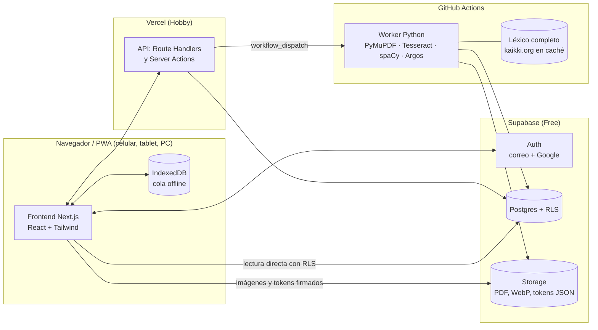

# 03 · Estructura del sistema y módulos

## 1. Vista general



**Flujo de un libro.** El lector sube el PDF directamente a Storage (subida reanudable TUS) → la API registra `books`/`jobs` y dispara el workflow → el worker procesa página por página y publica `pages/{book}/{n}.webp` y `pages/{book}/{n}.json` → la interfaz se suscribe con Realtime a `jobs` para mostrar el avance.

**Flujo de una consulta.** Al abrir una página, el cliente descarga su JSON de tokens, que ya trae el léxico de esa página (lemas, género y significados). Tocar una palabra no hace ninguna petición de red (RNF-01): el panel se pinta con datos locales y la consulta se registra en `user_words` de forma asíncrona (con la cola offline si no hay red).

## 2. Componentes

| Componente | Responsabilidad | Se relaciona con |
|---|---|---|
| **Frontend web (PWA)** | Pantallas responsive: ingreso, grupos, biblioteca, lector, panel de palabra, diccionario personal, ejercicios. Cola offline de consultas y anotaciones. | Con la **API**, para las acciones con reglas (crear grupo, unirse, subir libro); con **Supabase Auth**, para la sesión; con **Postgres** (lectura directa protegida por RLS) para el diccionario, el progreso y las anotaciones; con **Storage**, para descargar imágenes y tokens mediante URLs firmadas. |
| **API (Next.js en Vercel)** | Punto de entrada de las operaciones que requieren validación o privilegios: crear o unirse a grupos, registrar subidas (huella, límites, deduplicación RN-02), disparar el worker y administrar grupos. | Con el **Frontend**, del que recibe peticiones; con **Postgres**, donde persiste los cambios; con **GitHub Actions**, al que dispara con `workflow_dispatch` (ADR-006). |
| **Supabase Auth** | Registro, ingreso con correo y contraseña y con Google, recuperación de contraseña y emisión de JWT. | Con el **Frontend** (sesión) y con **Postgres** (`auth.uid()` en las políticas RLS). |
| **Postgres + RLS** | Persistencia de perfiles, grupos, membresías, libros, trabajos, léxico usado, vocabulario personal, progreso y anotaciones. Aplica RN-03 y RN-04 en la propia base de datos. | Con todos los componentes. |
| **Storage** | PDF originales (privados), imágenes WebP y JSON de tokens por página. Las políticas de acceso replican RN-03. | Con el **Worker**, que escribe; con el **Frontend**, que lee mediante URLs firmadas. |
| **Worker de procesamiento (Python en Actions)** | PDF → imágenes → OCR con cajas → tokenización y lematización → verbos separables → enlace al léxico → traducción de glosas faltantes → detección de campos de ejercicio → publicación por página. Reanudable. | Con **Storage** (lee el PDF y escribe las páginas); con **Postgres** (actualiza `jobs`, inserta en `lexicon` las entradas usadas); con el **léxico completo** en la caché de Actions. |
| **Constructor de léxico (script único)** | Descarga el volcado de Wiktionary alemán de kaikki.org, lo filtra y lo normaliza (lema, tipo, género, plural, acepciones, traducciones al español y formas) y lo guarda comprimido como artefacto de caché para el worker. | Con el **Worker**, que lo consume. |

## 3. División por módulos (dominio)

| Módulo | Contenido | Requisitos |
|---|---|---|
| M-1 Cuenta | Registro, ingreso (correo y Google), recuperación, perfil | RF-01–05, RNF-05 |
| M-2 Grupos | Grupos, membresías, invitaciones, roles | RF-06–10 |
| M-3 Biblioteca | Subida, deduplicación, estado, biblioteca, quitar libro | RF-11, 13–15, RNF-11 |
| M-4 Procesamiento | Worker OCR/NLP, cola, reanudación | RF-12, RNF-03, RNF-04 |
| M-5 Lector | Paginación, capa de texto, modo lectura, zoom, progreso, coloreo | RF-16–20, 26, RNF-02 |
| M-6 Léxico | Panel de palabra, género y color, lematización, separables | RF-21–25, RNF-01 |
| M-7 Vocabulario personal | Registro automático, marcas de "vista", diccionario, filtros, exportación | RF-27–32 |
| M-8 Ejercicios | Anotaciones libres, campos detectados, reinicio | RF-33–35, RNF-14 |
| M-T Transversal | Responsive, PWA/iOS, accesibilidad, RLS, pruebas, respaldos | RF-36–37, RNF-06–10, 12, 13, 15 |

## 4. Estructura del repositorio (monorepo)

```
My-Deutsch/
  app/ (Next.js App Router)      # rutas: /login, /grupos, /g/[id], /libro/[id]/[pagina], /diccionario
  components/                    # UI: reader/, word-panel/, dictionary/, ui/ (shadcn)
  lib/
    domain/                      # lógica pura y probada: gender.ts, vocab.ts, coords.ts, search.ts
    supabase/                    # clientes (browser/server) y tipos generados
  supabase/
    migrations/                  # SQL con RLS (lo vigila el hook post-edit)
    tests/                       # pruebas de políticas RLS (pgTAP)
  worker/                        # Python (uv): pipeline/, lexicon/, tests/
  .github/workflows/             # ci.yml, process-book.yml, build-lexicon.yml, backup.yml
  docs/                          # esta documentación
  e2e/                           # Playwright (Chromium + WebKit/iPhone)
```

## 5. Presupuesto de capacidad (plan gratuito)

| Recurso | Límite gratuito | Uso estimado (25 usuarios, 10 libros) |
|---|---|---|
| Supabase DB | 500 MB | Léxico usado ≈ 30–60 MB (solo lemas que aparecen en los libros, ADR-003); datos de usuarios < 20 MB |
| Supabase Storage | 1 GB | ≈ 35 MB por libro de 200 páginas (WebP + JSON) → ≈ 350 MB; los PDF originales se borran tras procesarlos con éxito |
| Supabase egress | 5 GB/mes | ≈ 25 usuarios × 300 páginas × 0,2 MB ≈ 1,5 GB/mes |
| Vercel Hobby | 100 GB de ancho de banda | Muy por debajo; las imágenes salen de Supabase |
| GitHub Actions | 2 000 min/mes (repo privado), ilimitado si es público | ≈ 15–25 min por libro |

**Nota:** Supabase pausa los proyectos gratuitos tras 7 días sin actividad; un workflow semanal de Actions hace una consulta liviana para evitarlo.

## 6. Decisiones de arquitectura
Ver `docs/decisiones/` (ADR-001 a ADR-005).
