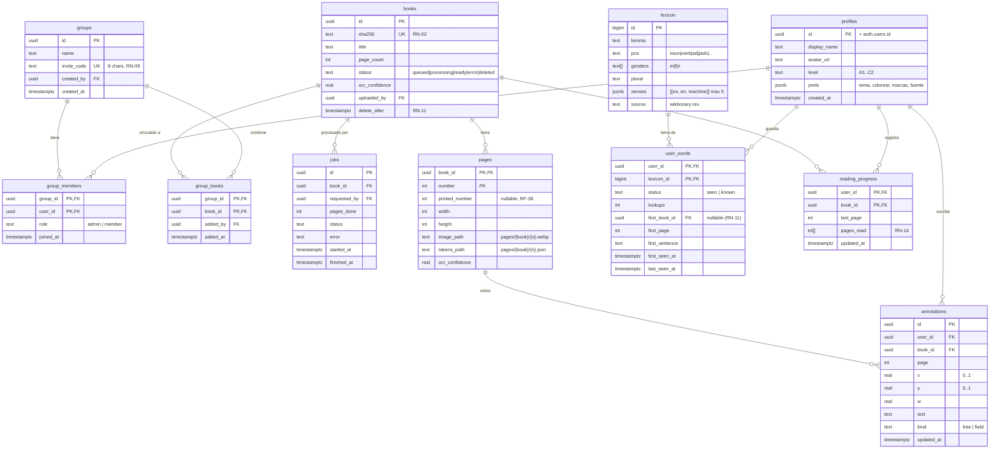

# 04 · Modelo de datos



## Archivo de tokens por página (`pages/{book}/{n}.json`)

No se guarda en Postgres: se sirve desde Storage como archivo estático (rápido y con caché), lo que mantiene la base de datos pequeña.

```json
{
  "v": 1,
  "size": [1600, 2263],
  "lines": [[0, 12], [13, 25]],
  "paragraphs": [[0, 25]],
  "images": [[0.08, 0.55, 0.84, 0.30]],
  "fields": [[0.12, 0.71, 0.30, 0.02]],
  "tokens": [
    { "t": "Häuser", "b": [0.112, 0.081, 0.064, 0.018], "l": 431, "c": 0.97 },
    { "t": "ging",   "b": [0.30, 0.12, 0.04, 0.018],  "l": 902, "f": "pret" },
    { "t": "Normalerweise", "b": [0.80, 0.30, 0.12, 0.018], "b2": [0.10, 0.32, 0.03, 0.018], "l": 1205 }
  ],
  "lex": {
    "431": { "lemma": "Haus", "pos": "noun", "g": ["n"], "pl": "Häuser",
             "senses": [{ "es": "casa", "m": false }, { "es": "edificio", "m": false }] },
    "902": { "lemma": "anrufen", "pos": "verb", "senses": [{ "es": "llamar (por teléfono)", "m": false }] }
  }
}
```
`b` = caja relativa [x, y, ancho, alto] (0–1) · `l` = id de léxico · `c` = confianza del OCR · `sep` = índice del token pareja de un verbo separable · `b2` = caja de la segunda parte de una palabra cortada con guion al final de línea (RF-39) · `m` = traducción automática · `f` = forma del token respecto a su lema (`pret` pretérito, `part` participio, `pres` presente, `pl` plural, `comp` comparativo, `sup` superlativo; RF-21).

`lines` y `paragraphs` son rangos `[primer, último]` de índices de `tokens`, **ambos inclusivos**. `lib/domain/page.ts` (`parsePage`) valida el archivo: `v` igual a 1, cajas entre 0 y 1, cada `l` presente en `lex`, `sep` dentro de los tokens, `f` conocida y máximo 5 acepciones por entrada (RN-12).

`number` es el índice de la página lógica (una hoja doble del PDF produce dos, RF-38) y `printed_number` el número impreso en el pie, si se detecta.

## Políticas RLS (resumen)
- `profiles`: cada usuario lee y edita la suya; los miembros de un grupo en común pueden leer `display_name` y `avatar_url`.
- `groups`, `group_members`, `group_books`: lectura para miembros; escritura de administración solo para `role = 'admin'` (las funciones `join_group(code)` y `leave_group(id)` son `security definer` y aplican RN-08 y RN-09).
- `books`, `pages`, `jobs`: lectura si existe una fila en `group_books` de un grupo del usuario; escritura solo con el service role (worker).
- `lexicon`: lectura para cualquier usuario autenticado; escritura solo con el service role.
- `user_words`, `reading_progress`, `annotations`: `user_id = auth.uid()` para todas las operaciones (RN-04).
- Storage `pages/`: lectura con la misma condición que `books`; `uploads/`: cada usuario escribe solo en `uploads/{auth.uid()}/`.
